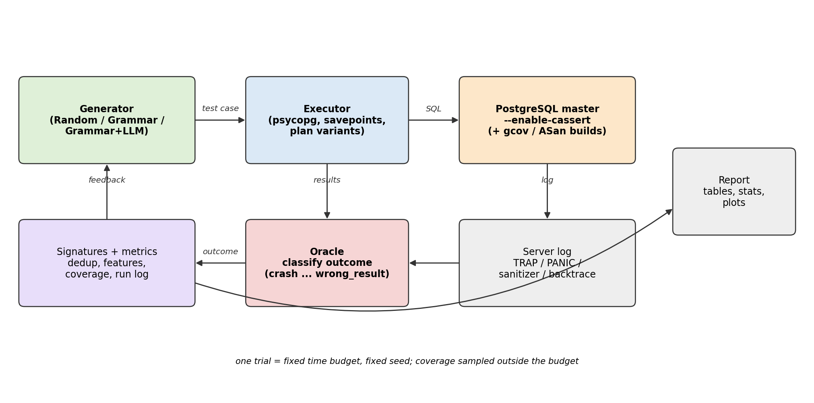
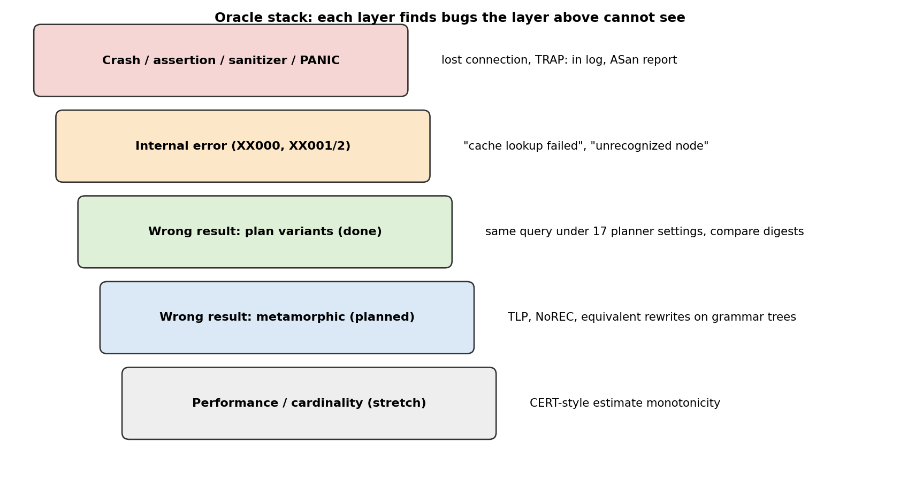
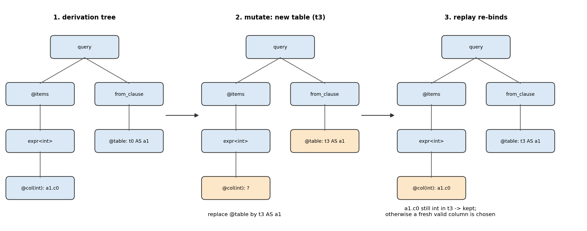
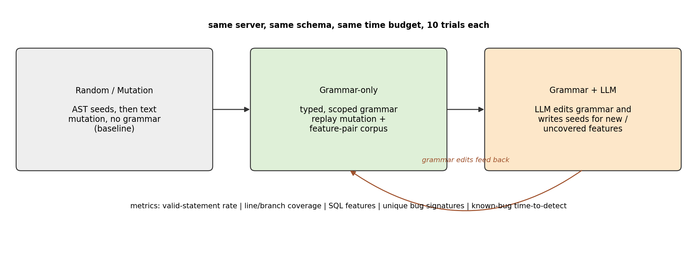
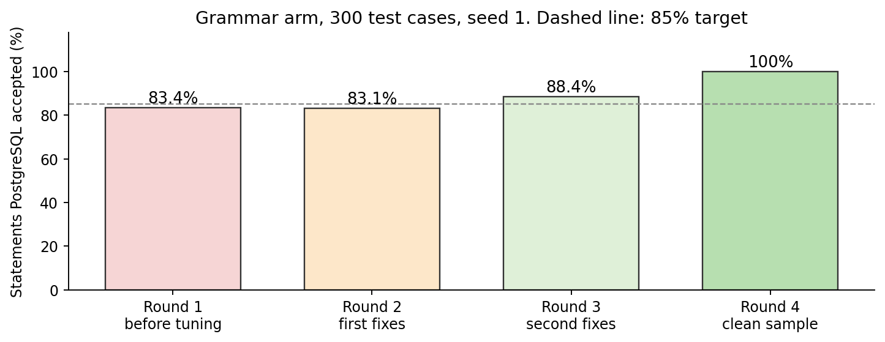
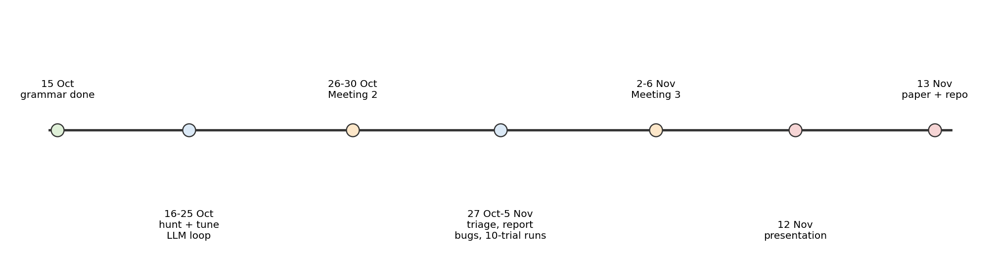

\newpage

# 0. How to read this

This is the one document that covers the project from the start. The two
study guides next to it go deeper on one half each: `01_project_so_far` is
what already runs, `02_future_plan` is the schedule through 13 November.
If those two and this one disagree, the newer measurement wins, and that
measurement is in Section 8.

Venu, Bhuvan, and Gowtham. Every number below was measured. Anything not
built yet is marked **(planned)**. Citations of other fuzzers are marked
**(verify)** and are not to be copied into the paper until the paper itself
has been checked.

Read it in order the first time. Section 1 is the whole idea in a few
pages. Section 2 is how to run the code. Sections 4 to 7 are how the code
works. Section 8 is what the server actually did. Section 10 is what we
will do before 13 November. Section 12 is the word list, if a term in the
middle is new.

A few words, before they show up in a sentence:

| Word | In this project it means |
|---|---|
| Fuzzer | A program that invents inputs and watches what breaks |
| Test case | A handful of SQL statements, run together, then undone |
| Oracle | The part that decides "this run looks like a bug" |
| Grammar | The rules that say which SQL we are willing to invent |
| Arm | One way of inventing SQL. We compare three arms |
| Valid | The server accepted the statement and ran it |
| Candidate | A run the oracle thinks is a bug, before a person has checked it |

# 1. The project in one page

**Goal.** Generate SQL, run it on PostgreSQL built from source with
assertions on, and notice when the server crashes, trips an assertion, or
returns the wrong rows. Then compare three ways of generating that SQL,
under the same server, the same schema, and the same time budget:

```text
Random/Mutation   ->   Grammar-only   ->   Grammar + LLM
```

The first arm builds a small SQL tree and then mutates the text. It does
not know types. The second arm derives SQL from a typed, scoped grammar and
mutates the derivation tree, so most statements still make sense after a
change. The third arm **(planned)** lets a language model read recent
PostgreSQL commits and propose new grammar rules. A proposal counts only
after the server runs it.

**The same idea, said slowly.** Imagine three students writing practice
questions for a database exam.

- The first student writes a correct question, then changes random letters
  and words. Most of the results are nonsense. That is the random arm. It
  is the baseline. If our grammar cannot beat nonsense, the grammar is not
  earning its keep.
- The second student writes from a checklist: the tables that exist, the
  types of the columns, and the places where an aggregate is legal. Most of
  the questions are real SQL. That is the grammar arm. It is what we have
  been running.
- The third student reads the notes for features that were added this year
  and adds those features to the checklist. That is the language-model arm.
  It is not built yet. When it is, a suggestion only counts if PostgreSQL
  actually runs it.

All three students use the same database, the same clock, and the same
answer key. Only the way they write questions changes. That is what makes
the comparison fair.

**Why this is hard.** Almost all random strings are rejected by the parser,
so a careless fuzzer never reaches the planner, which is where the
interesting bugs are. And many database bugs do not crash. The server
returns rows, and the rows are wrong. We need a generator that produces
real SQL, and an oracle that can see a silent mistake.

A concrete picture of the two failure modes:

```text
SELECT a1.c0 FROM t0 AS a1 WHERE a1.c0 = 'hello';
```

If `c0` is an integer, PostgreSQL rejects this. The fuzzer learned nothing
about the planner. It only learned that text is not an integer. That is a
semantic error, and we do not call it a bug in PostgreSQL.

```text
SELECT a1.c0 FROM t0 AS a1 WHERE a1.c0 > 0;
```

This is legal. Suppose one planner setting returns the rows `(1), (2)` and
another, for the same data, returns `(1)`. The server did not crash and
did not print an error. The rows are still wrong. That is the bug we are
built to notice.

**Grades.** Implementation and results are 50%. Meetings and the final
presentation are 25%. The report, in ACM/FSE format, is 25%. The top of
the 50% needs a previously unknown bug that the PostgreSQL developers
accept: a fix commit, or a reply on the mailing list. The report and the
meetings do not. We design the paper so it is complete either way, and we
still spend the hours looking for the bug.

Said as a grade, not as a slogan. The 25% for meetings is "can each of us
explain the grammar, the oracle, and this plan". The 25% for the report is
five graded parts: a real motivating example, the workflow, the research
questions, related work, and threats to validity. The 50% is the tool and
what it found. The course gives the top of that 50% for a bug the
developers did not already know about. A fix commit is the best evidence.
A reply on pgsql-bugs or pgsql-hackers, saying the report is a real bug,
is the evidence we can still get before 13 November if we file in week 2.
A strong paper with zero new bugs is a real paper. It is not the top of
that 50%. We say both of those sentences out loud.

**Dates.** Meeting 2 is 26-30 October. Meeting 3 is 2-6 November. The
presentation is 12 November. The paper and the repository are due
13 November 2026.

## 1.1 Three claims

1. **One tree, four jobs.** Generation builds a derivation tree. Mutation
   edits a subtree and replays it, re-binding names and types. Metamorphic
   testing **(planned)** rewrites one typed node. Reduction **(planned)**
   replaces a subtree by the smallest alternative of the same type. The SQL
   text is only how the tree is printed.
2. **We measure soundness, we do not announce it.** The generator is sound
   for its fragment when the server accepts the SQL, and incomplete on
   purpose because it is not all of SQL. The number is the valid-statement
   rate. On 16 October the latest sample accepted every statement: 966 of
   966 (Section 8). The round before that was 88.4%. The oracle is sound
   only for the queries we allow it to compare, and incomplete because many
   bugs cause no mismatch. Its number will be triage precision.
3. **The model proposes. The server decides.** No generated text enters the
   fuzzer, and none of it becomes a number in the paper, unless the grammar
   parses, the server runs the statements, and the changed lines of that
   commit gain coverage.

**Claim 1, unpacked.** Suppose the generator prints
`SELECT a1.c0 FROM t0 AS a1`. Internally it did not store that string
first. It stored a tree: "query", then "select an integer column", then
"the column chosen was `t0.c0`, alias `a1`". Mutation edits the tree. If
it swaps `t0` for `t3`, replay looks at the recorded column and asks "does
`t3` still have an integer in that position?". If yes, the name is kept.
If no, a legal integer column of `t3` is chosen. The string is printed
only at the end. The same tree is what we will later rewrite for the
metamorphic oracle, and what we will shrink when a bug candidate is too
long to read. Four jobs, one representation. Generation and mutation exist
today. Rewrite and reduction are the next code.

**Claim 2, unpacked.** "Sound" here does not mean "finds every bug". It
means "when we say something, it is justified". For the generator, the
justified sentence is "the latest sample accepted 966 of 966 statements". We
do not say "the grammar is correct". For the oracle, the justified sentence
will be "of the candidates we reported, this fraction survived triage".
We do not say "every bug is caught". Many bugs return the same wrong
answer no matter how you plan the query. Our current oracle cannot see
those. Section 10 is how we will see more of them.

**Claim 3, unpacked.** A language model is good at reading a commit
message and guessing a query that might touch the new code. It is bad at
being trusted. So the model never sits in the loop that generates the
thousands of statements. It proposes a grammar change. Three checks follow,
and all three have to pass: the change is legal grammar, the server runs
the new statements, and the lines that commit added are actually executed.
If the third check fails, the proposal was pretty and useless. Token cost
is written next to the coverage number, so "the model helped" is not free.

## 1.2 Who does what

The code was built in three pieces: the server harness, the generators, and
the experiment runner. From this meeting on:

| Person | Job |
|---|---|
| Venu | Recent PostgreSQL features. Read commits since the last release and extend the grammar so MERGE, SQL/JSON, generated columns, partitions, and new planner rewrites actually run. |
| Bhuvan | The same feature work, and the first pass on every bug candidate a campaign prints: reproduce it, shrink it, decide if it is real. |
| Gowtham | The rest: the three-arm experiment, the statistics, the LLM arm, and the paper. |

Two people on new code, because that is where an unknown bug is most
likely. One person also on candidates, so a find is not left in a log. One
person on the paper, so the grade does not wait for a crash.

Why this split, in one picture. A new feature is a few thousand lines that
the regression tests touch lightly. That is the best place to look for a
bug nobody has filed. Two people read that code and aim the grammar at it.
A campaign can print a candidate at 2 a.m. If nobody shrinks it, it stays
a directory of SQL. Bhuvan does that first pass. The paper, the statistics,
and the model arm still have to exist if the candidate never comes.
Gowtham keeps those moving on the same days the servers are busy.

# 2. How to run it

All of this was brought up on WSL Ubuntu, without Docker and without root.
The laptop that runs the campaigns is a different machine from the one that
edits the documents. Commands below are from `src/`.

What "up" means, in order. PostgreSQL is compiled from source, with
assertions switched on. Two servers are started, on ports 5432 and 5433.
Python, from the `src` directory, talks to them over `127.0.0.1`. A run
either prints a short sample summary or writes a results directory. If a
step before Python fails, the later numbers are meaningless, so the order
matters.

## 2.1 The server

PostgreSQL `20devel`, commit `d733fca`, built with assertions and debug
symbols. The build took about 13 minutes on 20 cores. The scripts live in
`harness/local/`:

| Script | What it does |
|---|---|
| `build_pg.sh` | Configure and build PostgreSQL from a git checkout |
| `pg_local.sh` | Init, start, and stop N servers. Logs go to `~/pgfuzz/data/pg-<worker>/postgresql.log` |

Two servers is the setup we use: ports 5432 and 5433, on `127.0.0.1`.
Use `127.0.0.1`, not `localhost`. On Windows, `localhost` tried IPv6 first
and a connection took 131 seconds. `127.0.0.1` took 0.2 seconds.

The Python config points at the log. On Windows that path is the WSL
share, with `{worker}` filled in by the runner:

```text
//wsl.localhost/Ubuntu/home/<user>/pgfuzz/
    data/pg-{worker}/postgresql.log
```

Inside WSL it is the normal home path. `{port}` is filled in the same way.

A short acceptance check, once the server is up:

```text
python -m pgfuzz selftest configs/local.yaml
```

That is 10 checks: SQLSTATE mapping, continuing after an error, timeouts,
no state leaked between test cases, and recovery after a lost connection.
Ours passed 10/10.

Why assertions, in one line of log. A release build of PostgreSQL often
keeps going after an internal check would have failed. Our build is
configured with `--enable-cassert` and debug symbols. When an assertion
fails, the server writes a line like `TRAP: failed Assert(...)` with a
file and a line number, and the connection drops. The oracle treats that
as a candidate. Without the assertion, the same bug can return wrong rows
and look like success.

Why two servers. A four-hour hunt uses one Python worker per server
(`-j 2`). They do not share a database. Each has its own data directory
and its own log. `{worker}` in the config is 0 or 1, which is how the
runner finds the right log.

Why not Docker on this laptop. The `harness/docker` directory can build
the same server inside a container, including a coverage build and a
sanitizer build. This machine has no Docker. `harness/local/build_pg.sh`
and `pg_local.sh` do the same job without root. The Dockerfile stays in
the repository for a machine that does have Docker.

## 2.2 Python

Python 3.10 or newer. The laptop that produced the sample numbers uses a
virtualenv. From `src/`:

```text
pip install -r requirements.txt
python -m pytest
```

84 tests passed after the random/mutation baseline was added. 65 had passed
before that, when the harness and the grammar were the whole suite. The
smoke config (`configs/smoke.yaml`) uses a fake server with planted bugs.
It tests the tooling. Never put its numbers in the paper.

`pytest` does not need the server. It checks the grammar, the random
generator, the oracle, and the experiment runner against small fixtures.
The 65-to-84 jump is the random arm's own tests being added. A green
`pytest` does not mean PostgreSQL is bug-free. It means our Python still
does what those tests say.

## 2.3 The commands

| Command | What it does |
|---|---|
| `run CONFIG [-j N] [--no-plots]` | One experiment. Re-running skips finished trials. |
| `sample CONFIG -n N [--execute] [--seed S]` | Print SQL, or run it and print a validity summary. |
| `selftest CONFIG` | The 10 executor checks. |
| `replay CONFIG FILE.sql` | Run one file and print the oracle's verdict. |
| `report DIR` | Rebuild tables and plots from a finished run. |
| `features FILES` | Which SQL features a file covers. |

The command we have actually used for the numbers in Section 8:

```text
python -m pgfuzz -q sample configs/local.yaml \
    -n 300 --execute --seed 1 \
    --out ../results/sample3
```

`-q` keeps the log quiet. `-n 300` is 300 test cases, not 300 statements
(a test case is several statements). `--execute` talks to the real server.
`--seed 1` makes the run repeatable.

How to read that command out loud. `python -m pgfuzz` is the tool. `-q`
hides the per-statement chatter. `sample` means "generate, do not start a
multi-hour experiment". `configs/local.yaml` is the grammar arm against
the local server. `-n 300` is three hundred test cases. `--execute` is
the difference between printing SQL and sending it. `--seed 1` fixes the
random choices, so a later run with the same grammar and the same seed
makes the same choices. `--out` writes the SQL and the summary under
`results/sample3`.

The next command, not started yet, is the hunt. Two grammar trials, four
hours each, statement timeout 3 seconds, differential oracle on:

```text
python -m pgfuzz run configs/hunt.yaml -j 2 --no-plots
```

One job per server. Candidates land in
`results/hunt/grammar/trial-NN/failures/<signature>/`.

What that directory contains, when it is non-empty. The SQL that provoked
the candidate, the oracle's verdict, and the signature used to group it
with duplicates. `replay` can run that SQL again on a fresh server. A
person then decides whether it is a PostgreSQL bug, a bug in our grammar,
or a known duplicate. Empty `failures/` after four hours is a result too:
zero candidates, and we say zero.

## 2.4 Which config

| File | Use it for |
|---|---|
| `smoke.yaml` | The fake server. Tooling only. |
| `stage1.yaml` | The real comparison skeleton: random/mutation arm on, grammar arm on, LLM arm off. |
| `local.yaml` | Development. Grammar arm, 5 second statement timeout, differential oracle on. This is what `sample` uses. |
| `hunt.yaml` | Two trials of 14400 seconds. Grammar arm, `mutate_prob` 0.5. |

`stage1.yaml` names the random arm as
`generator.random_generator.generator:RandomGenerator` and the grammar arm
as `pgfuzz.grammar.generator:GrammarGenerator`. Both see
`corpus/schema.yaml`.

Which file to open, as a habit. Day-to-day tuning uses `local.yaml` and
`sample`. The comparison experiment uses `stage1.yaml`. The overnight run
uses `hunt.yaml`. `smoke.yaml` is only for `pytest` and for checking that
the runner still writes a report. If a number came from `smoke.yaml`, it
is not a PostgreSQL result.

## 2.5 What a sample summary means

The JSON printed at the end is the thing to read:

| Field | Meaning |
|---|---|
| `testcases` | How many test cases were generated. |
| `statements` | How many SQL statements those contained. |
| `ok_rate` | Share of statements the server accepted and ran. |
| `outcomes` | `ok`, `semantic_error`, `runtime_error`, `timeout`, `syntax_error`. |
| `top_errors` | The messages, with identifiers replaced by `?`, and how often each appeared. |
| `worst_alternatives` | Grammar choices with a low success rate. `expr:332 ok=15% n=26` means alternative 332 of rule `expr` succeeded 15% of the time, over 26 uses. |
| `bug_candidates` | Crashes, assertions, internal errors, or wrong results. This is the number we care about. |
| `executor.checked` | Queries the differential oracle compared. |
| `executor.variant_runs` | Extra runs of those queries under other planner settings. |
| `generation_failures` | Times the grammar itself gave up. Ours is 0. |

Semantic errors are "this SQL names something that does not exist, or is
not allowed here". Runtime errors are "the SQL is legal, and this
particular value is not" (overflow, a NULL in a NOT NULL column, no
partition for this row). A high runtime count with a high `ok_rate` means
we are past the parser. A high semantic count means the grammar is still
producing SQL the planner refuses.

The third sample, read field by field, so the JSON is not a wall of keys.
300 test cases contained 929 statements. `ok_rate` was 0.8837, which is
821 divided by 929. The other outcomes were 74 runtime errors, 28 semantic
errors, and 6 timeouts. There was no syntax error. `bug_candidates` was 0.
`executor.checked` was 181 and `variant_runs` was 362, so the differential
oracle did run and found no mismatch. `generation_failures` was 0: every
test case the grammar started, it finished. `corpus` was 122. Of 415
alternatives, 393 were used. The run took 56.1 seconds. That is round 3.
Round 4, after the scope and value fixes, accepted 966 of 966 and is
written out in Section 8.2.

`ops` says how the 300 test cases were built: 168 fresh derivations, 32
inserts, 66 regens, 12 drops, and 22 splices. `finds_by_op` says which of
those did something new enough to keep: 99 fresh, 16 inserts, 2 splices,
5 regens. Fresh generation is still where most of the new behaviour comes
from. That is expected this early. The corpus has not had hours to grow.

A `worst_alternatives` line such as `expr:332 ok=15% n=26` is a to-do
item, not a bug. Alternative number 332 of the rule `expr` was used 26
times and accepted 15% of the time. The next edit either fixes that
alternative or lowers its weight so it is chosen less often. After the
third round the worst lines sit around 50% to 66%, which is why we stopped
tuning for the meeting.

# 3. What is in the repository

```text
harness/
  docker/            Dockerfile and scripts, for a machine that has Docker
  local/build_pg.sh  build PostgreSQL without root
  local/pg_local.sh  start and stop local servers
src/pgfuzz/
  core/              TestCase, outcomes, the plug-in interfaces
  eval/              oracle, signatures, differential plans, statistics
  grammar/           the .pgg engine and GrammarGenerator
  reference/         PostgresExecutor, a fake executor, an old stand-in generator
  runner/            experiments, trials, selftest
  runlog/, report/   the log format and the report
src/generator/       Stage 1 random/mutation baseline
  common/            a small SQL AST, and the schema reader
  random_generator/  seeds, text mutators, the Generator plug-in
src/grammar/postgres.pgg
src/corpus/schema.sql and schema.yaml
src/configs/         smoke, stage1, local, hunt
src/tests/           84 tests
paper/               the FSE-format report
docs/                these guides, the slides, the figures
progressmeet1/       the pack for the progress meeting
```

A plug-in is named in YAML as `package.module:ClassName`. The runner
constructs it with the `params` block.

What each directory is for, in the order a test case walks through them.

`harness/` builds and starts PostgreSQL. Python never compiles C. It only
connects. `src/pgfuzz/core/` is the shared vocabulary: a test case, an
outcome, and the two plug-in types (`Generator` and `Executor`).
`src/pgfuzz/grammar/` turns `postgres.pgg` into SQL. `src/generator/` is
the other generator, the one that mutates text. `src/pgfuzz/reference/`
is the executor that speaks to a real server, plus a fake executor for
tests. `src/pgfuzz/eval/` looks at what the executor returned and decides
the outcome. `src/pgfuzz/runner/` is the clock: it loops until the time
budget is spent, one trial at a time, and it can resume. `runlog/` writes
the events. `report/` turns those events into tables. `corpus/` is the
database both generators share. `configs/` chooses which generator and
which server. `tests/` locks the behaviour we care about. `paper/` is the
report we will submit. `docs/` and `progressmeet1/` are for people, not
for the fuzzer.

A plug-in line in YAML looks like
`pgfuzz.grammar.generator:GrammarGenerator`. The part before the colon is
a Python module. The part after it is a class. The `params` underneath
become constructor arguments. Swapping an arm is a config edit, not a
rewrite of the runner. That is why the three arms can share one oracle.

# 4. The loop

{width=100%}

1. The generator returns a test case: a short list of SQL statements.
2. The executor runs them inside a savepoint, records the SQLSTATE, the
   message, and a digest of the result, and may re-run the query under
   other planner settings. Then it rolls back. The next test case sees the
   same database.
3. The oracle classifies the outcome from the SQLSTATE, the connection, and
   any new lines in the server log.
4. A signature collapses two crashes with the same stack into one bug.
   Metrics record the valid-statement rate, the SQL features, and coverage
   samples.
5. Feedback (a new feature, a new signature) goes back to generators that
   want it. The random arm ignores it. The grammar arm keeps a corpus.
6. A report turns many trials into tables.

Savepoints are used because rebuilding the database for every test case
costs seconds, and a rollback costs very little. The selftest checks that
nothing leaks.

The executor returns facts. It does not decide what a bug is. That decision
is the oracle's, so a new oracle does not require a new executor.

One test case, walked through the six steps. The generator returns two
statements: `CREATE INDEX ...` and `SELECT a1.c0 FROM t0 AS a1 WHERE a1.c0 > 0`.
The executor opens a savepoint, runs the index, runs the select, and
stores the SQLSTATE (success is `00000`) and a digest of the rows. Because
the select is deterministic, it runs the select twice more under two
planner settings, still inside savepoints, and compares digests. Then it
rolls the outer savepoint back, so the index is gone. The oracle sees
success and matching digests, and records `ok`. No new feature and no new
signature, so this particular test case may not enter the corpus. The
report later counts it toward the valid-statement rate.

The rollback is the reason a test case cannot "poison" the next one. If
we created a table and left it, later queries would see a schema the
grammar did not know about, and the run would not be repeatable. The
selftest includes a check that state does not leak. It passed.

# 5. The oracle

| Outcome | Roughly | A bug? |
|---|---|---|
| `ok` | The statement ran | No |
| `syntax_error` | SQLSTATE 42601 | No |
| `semantic_error` | Other class-42 errors, and similar "not allowed" errors | No |
| `runtime_error` | Bad values, constraint failures | No |
| `timeout` | Statement timeout, SQLSTATE 57014 | No |
| `resource_limit` | Out of memory, and the known "invalid memory alloc request size" case | No |
| `internal_error` | `XX000` and the "should not happen" messages | Yes, a candidate |
| `crash` | Lost connection, `TRAP:`, `PANIC`, a sanitizer report | Yes |

How to hear this table. The first five rows are PostgreSQL doing its job.
It refused bad SQL, or it refused a bad value, or it stopped a statement
that ran too long. We count those, because they tell us whether the
grammar is aimed well. We do not file them as bugs. The last two rows are
PostgreSQL breaking a promise: an internal "this cannot happen" error, or
a process that died. Those are candidates. A wrong result is also a
candidate. It is not a SQLSTATE. Section 5.1 is how we notice it.

SQLSTATE, in one sentence. It is a five-character code on every error.
Class `42` is "your SQL is not allowed" (`42601` is a syntax error, other
`42xxx` codes are semantic). Class `22` is a bad value, such as overflow.
Class `23` is a constraint, such as NOT NULL or a duplicate key. `57014`
is "cancelled because of the statement timeout". `XX000` is an internal
error. We classify from the class, not from the English text, because the
text changes and the class does not.

Two crashes can be the same bug. A signature is the fingerprint we use so
they count once. The strongest fingerprint is the top of the stack, with
generic frames such as `abort` removed. Next is the assertion text and the
file. Next is the error message with numbers and names blanked out, which
is why the sample summary shows `"?"`. For a wrong result, the fingerprint
is which planner setting disagreed, plus the shape of the query. "Unique
bugs" in the paper will mean unique signatures. That can under-count (two
bugs, one message) or over-count (one bug, two messages). We will say so
in the threats section.

The server log is read only after a failure. Reading it on every statement
made 20 small test cases take 0.99 seconds. Skipping it until something
fails brought that to 0.15 seconds.

{width=92%}

The crash layer and the internal-error layer are running. The plan-variant
layer is running (next section). Metamorphic oracles and a performance
oracle are planned.

## 5.1 Wrong results, by changing planner settings

A query that should not care about planner settings is run several times,
each time inside a savepoint, with a different GUC. Seventeen settings are
available (join order, hash and merge joins, parallelism, partition-wise
joins, memoization, and others). `local.yaml` and `hunt.yaml` ask for two
extra variants per eligible query (`differential.per_query: 2`).

A query is eligible when it is deterministic: no `LIMIT`, no `random()`,
no aggregates whose result depends on input order. Results are compared as
multisets, so row order does not matter. Floats are masked in aggregating
queries. A mismatch is a candidate, and `replay` runs it again before
anyone writes a report.

In the third sample the executor checked 181 queries and ran 362 variant
executions. No mismatch.

What this oracle cannot see: a bug that is wrong under every planner
setting. That is why the metamorphic oracles are next. They rewrite the
derivation tree (for example, `WHERE p` against `WHERE p OR p`, or a
`COUNT` against a count of the filtered rows) and compare. Same tree, so
the rewrite stays typed.

A small example of the plan oracle. Take `SELECT a1.c0 FROM t1 AS a1 WHERE a1.c0 > 1`.
With hash join allowed, the server might scan `t1` one way. With
`enable_hashjoin` off, it must use another plan. The rows, as a multiset,
must match. Order does not count: `(1), (2)` and `(2), (1)` are the same
digest. If the query is `SELECT SUM(a1.c2) FROM t0 AS a1` and `c2` is a
float, the last digits can change with the order of addition. We mask
those digits before comparing, so a legal rounding difference is not filed
as a bug.

What "17 settings" means, without memorising the list. They are switches
PostgreSQL already has: only nested-loop joins, only hash joins, only
merge joins, no hash aggregates, index scans only, sequential scans only,
parallel query forced on, partition-wise join and aggregate, partition
pruning off, join reordering off, a tiny `work_mem`, self-join elimination
off, JIT, and a few close relatives. We do not invent new planner modes.
We turn the existing ones off and on. For each eligible query, the config
asks for two of those, chosen deterministically from the query text, so
the same query is always compared against the same pair.

Why not every query. `SELECT a1.c0 FROM t0 AS a1 LIMIT 1` has no promised
row. `SELECT random()` changes every call. `string_agg` without `ORDER BY`
can change with the scan order. Comparing those would create false
candidates. The grammar tries not to emit them. Where it emits
`string_agg` or `array_agg`, it attaches `ORDER BY`, so the result does
not depend on the plan.

# 6. The grammar

The file is `src/grammar/postgres.pgg`. About 13 types and about 100 rules.
The engine is `src/pgfuzz/grammar/`.

Why we did not reuse PostgreSQL's own `gram.y`. That file is the real
parser grammar. It knows that `SELECT` is followed by a list. It does not
know that the name after `SELECT` has to be a column of a table in `FROM`,
or that an integer column cannot be compared with a JSON value, or that an
aggregate cannot appear in `WHERE`. A random walk of `gram.y` is almost
always rejected by the analyser. The planner never runs. Our file is much
smaller, about 100 rules, and every rule carries a type and a scope. The
price is that we do not cover all of SQL. That incompleteness is
intentional, and we measure what fraction of our fragment the server
accepts.

## 6.1 A rule, in one example

```text
expr<T>     : <5> @lit(T) ;
expr<T:num> : <2> "(" expr<T> ("+" | "-" | "*") expr<T> ")" ;
expr<bool>  : <4> "(" expr<X:key> cmp expr<X> ")" ;
```

`expr<T>` means "an expression of whatever type was asked for".
`expr<T:num>` means "only if that type is numeric". The number in angle
brackets is a weight. `@lit(T)` is Python: it prints a literal of type T.
`X:key` is a type variable, bound the first time it is used, so both sides
of a comparison have the same type.

Thirteen types: `int`, `bigint`, `numeric`, `float8`, `text`, `boolean`,
`date`, `timestamptz`, `interval`, `jsonb`, `int4range`, `text[]`, `int[]`.
Classes such as `num`, `ord`, and `key` group them, so one rule can cover
"anything you can add" without listing eight types.

Generating `expr<int>` is a search for a derivation of
$\Gamma \vdash e : T$, where $\Gamma$ is the set of columns in scope. If an
alternative cannot be finished, the engine backtracks. It will not pick an
alternative whose shortest derivation is already deeper than the limit
(14). Past a soft depth (8) it prefers short alternatives.

Those three lines, turned into SQL a person can read.

- `expr<int> : <5> @lit(int)` can print `1` or `0`. The weight 5 means
  "prefer this over a rarer alternative". A literal is the simplest
  integer expression.
- `expr<int> : <2> "(" expr<int> "+" expr<int> ")"` can print `(1 + 0)`.
  The `:num` on the rule means this alternative exists only for types that
  can be added. It is not offered for `jsonb` or `text`.
- `expr<bool> : <4> "(" expr<X:key> cmp expr<X> ")"` can print
  `(a1.c0 = 1)`. `X` is chosen once, from the types that support equality,
  and both sides use that same `X`. So we do not generate `integer = jsonb`.
  We used to. One of the early semantic errors was exactly that, and the
  type variable is what forbids it.

The thirteen types are the ones in our schema: integers, big integers,
numeric, float, text, boolean, date, timestamp with time zone, interval,
JSON, an integer range, and two array types. A class is a nickname for a
group. `num` is "you can do arithmetic". `key` is "you can compare for
equality". Writing the rule once against the class is how the grammar
stays short.

Backtracking, with a failure. Suppose the engine is inside a query whose
only visible column is text, and it tries to build `expr<int>` from
`@col(int)`. There is no such column. That alternative fails, the scope is
restored, and another alternative is tried, usually a literal. If every
alternative fails, the parent rule fails too. The depth limit stops a
chain of `expr` calling `expr` from running forever. Depth 14 is the hard
stop. Past depth 8 the engine prefers the short alternatives, so a typical
statement stays readable.

## 6.2 Why `FROM` is expanded before `SELECT`

SQL writes the select list first, but the select list may only name tables
from `FROM`. The `^` mark expands a piece early and prints it in the
original place:

```text
select_core
  : SELECT @items ^from_clause ^where_clause?
  | SELECT @items ^from_clause ^where_clause? GROUP BY ^@group_keys having_clause?
  ;
```

`@table` picks a real table from the schema and gives it an alias (`a1`,
`a2`). `@col(int)` picks a visible integer column and prints it qualified
(`a1.c0`). Names do not collide, and a column of the wrong type is not
offered.

`@scope` opens a level that can see outer columns (a subquery in `WHERE`).
`@scope(isolated)` cannot (a derived table, a view). `@frame` limits a
`JOIN ... ON` condition to the two inputs of that join, which is what
PostgreSQL requires.

The `^` mark, as a reordering a person can see. The text we want is:

```text
SELECT a1.c0 FROM t0 AS a1 WHERE a1.c0 > 0
```

The select list is written first, but `a1` does not exist until `FROM`
has been chosen. So the engine expands `from_clause` first, then
`where_clause`, then the select list, and prints them in the usual order.
Without the caret, the select list would have to invent a column before
any table existed, and the statement would be invalid.

Aliases are `a1`, `a2`, and so on, not the table's real name. Two uses of
`t0` in one query would otherwise both be called `t0`, and `t0.c0` would
be ambiguous. `a1.c0` is not.

Scopes, as three nested boxes. A `WHERE` subquery can see the outer
query's columns. That is ordinary `@scope`. A derived table in `FROM`
cannot see the outer columns. That is `@scope(isolated)`. A `LATERAL`
subquery can see the columns of the `FROM` items to its left. That is
`@scope(lateral)`. `@frame` is the join version of the same idea: an `ON`
clause may name the two sides of that join, and not a table that appears
only outside it. PostgreSQL's error for getting this wrong is "invalid
reference to FROM-clause entry". We still have a few of those (Section
8.4). The rule is right often enough that the latest sample accepted every
statement. Round 3, before the last scope fixes, was 88.4%, and a few
FROM-clause references were still wrong. Round 4 closed that list on this
sample.

## 6.3 Grouping, in flags rather than in comments

After `GROUP BY`, a query is grouped. A plain column reference may only be
a grouping column. We learned this the hard way: early samples produced
"column must appear in GROUP BY" because a grouped query could still see
columns from outside. The scope now stops at a grouped level.

`agg_ok` is set in the select list of a grouped query and in `HAVING`. It
is cleared in `WHERE`. `in_agg` allows any column inside an aggregate, and
forbids a nested aggregate. `win_ok` allows window functions only in the
select list. `nonull` forbids a NULL literal, which we set for primary
keys, NOT NULL columns, and partition keys.

A query that shows why the flags exist:

```text
SELECT a1.c0 FROM t0 AS a1 WHERE count(a1.c0) > 0;
```

PostgreSQL rejects this. An aggregate in `WHERE` is not a property of the
expression. It is a property of where the expression sits. `agg_ok` is
that property. It is set on the select list of a grouped query and on
`HAVING`. It is cleared on `WHERE`, on `ON`, and on `GROUP BY`. The
alternative that prints `count(...)` is marked "only if `agg_ok` is set",
so the bad statement is not generated.

The same idea, for grouping:

```text
SELECT a1.c1 FROM t0 AS a1 GROUP BY a1.c0;
```

`c1` is not in the `GROUP BY`, so this is illegal unless `c1` is wrapped
in an aggregate. Once `@group_keys` has run, the query is grouped, and a
plain column reference may only be one of those keys. Early on, a grouped
query could still see columns from an outer query. That produced the
"must appear in GROUP BY" errors in the first sample. The scope now stops
at the grouped level.

`nonull` is the flag for "NULL is not a useful literal here". A primary
key, a NOT NULL column, and a partition key reject NULL at runtime. The
flag does not make every expression non-null. An expression such as
`CASE WHEN false THEN 1 END` is still NULL. That is why some NOT NULL
errors remain in Section 8.4.

## 6.4 Trees, replay, mutation

{width=100%}

Every statement is stored as a tree: which rule, which alternative, and
what each builtin chose (which table, which column). Replay walks the tree
and keeps a recorded choice when it is still valid. If the chosen column
no longer has the right type, a new valid column is chosen. That is why a
mutation does not leave a dangling name.

Four operators: **regen** (drop a subtree and derive it again), **splice**
(replace a subtree with one of the same type from a test case we kept),
**insert** and **drop** (add or remove a whole statement). A unit test
checks that replaying an unchanged tree prints the same SQL.

Replay, as a before and after.

```text
SELECT a1.c0 FROM t0 AS a1 WHERE a1.c0 > 1
```

The mutation replaces the table node `t0` with `t3`. Replay walks the
tree again. The recorded column was an integer named through alias `a1`.
`t3` has an integer column, so the comparison stays an integer comparison
and the alias stays `a1`. If `t3` had no integer, the column node would be
drawn again from the columns `t3` does have. The result is still SQL the
analyser can accept. A text mutation that changed `t0` to `t3` and left
`a1.c0` pointing at a column `t3` does not have would be a semantic error.
That difference is the whole point of storing the tree.

The four operators, and when each one is useful:

| Operator | What it changes | Why it is there |
|---|---|---|
| regen | One subtree is thrown away and derived again | A small edit that stays in the same query shape |
| splice | A subtree is replaced by one of the same type from a kept test case | Moves a useful fragment into a new query |
| insert | A whole extra statement is added | For example, an index in front of a query |
| drop | A whole statement is removed | Shrinks a test case that did something interesting |

In the third sample the counts were 168 fresh, 66 regen, 32 insert, 22
splice, and 12 drop. Fresh still dominates, which is what we expect
before the corpus has been fed by a long run.

## 6.5 What the grammar generator puts in one test case

Zero to two setup statements (an index, a table, a view, an `ALTER`, a
planner setting), then one or two statements that are usually queries and
sometimes `INSERT`, `UPDATE`, `DELETE`, `MERGE`, or `EXPLAIN`. Tables
created in the setup are visible afterwards.

A test case is kept in a corpus when it produced a new bug signature, a new
SQL feature, or a new pair of features. Later mutations prefer those
entries. In the third sample the corpus held 122 entries. Of 415 grammar
alternatives, 393 were used at least once. `generation_failures` was 0.

Why setup statements exist. A query against the shared schema always sees
`t0` and `t1`. A query that creates its own index, or its own table, then
selects from that table, reaches code the shared schema never touches.
The setup is rolled back with the rest of the test case. Zero, one, or two
setup statements, then one or two main statements, keeps each test case
short enough to read when it fails.

The corpus is a memory of "this was worth trying again". A test case is
kept if it produced a new bug signature, a new SQL feature, or a new pair
of features, and at least one statement succeeded. Later, splice and regen
prefer those entries. Pairs matter because a feature in isolation is often
already covered, and the bugs we want sit where two features meet: a
window function over a partitioned table, a merge into a table with a
generated column, and similar combinations. 122 entries after 300 test
cases means the corpus is young. A four-hour run is what fills it.

# 7. The random arm (Stage 1)

This is the baseline the grammar has to beat. It lives in `src/generator/`
and is wired in `configs/stage1.yaml`. It was the generator half of the
first stage, and it is in this tree now.

What it does, on purpose:

- Seeds are built with a small SQL AST (`generator/common/ast_nodes.py`):
  `SELECT`, `INSERT`, `UPDATE`, `DELETE`, `CREATE TABLE`. The seed itself
  is valid SQL.
- The seed is then mutated as **text**. Flip a character, delete a span,
  splice in a keyword, swap an operator, drop a clause. The mutators do
  not know types or scopes. Many mutants are invalid. That invalid rate is
  the number we will put next to the grammar's latest sample, which
  accepted every statement (966 of 966).
- Randomness comes from the trial seed (`ctx.rng`), so the same seed
  repeats. `feedback` does nothing. This arm is unguided.
- On a real run the seeds use `corpus/schema.yaml` (tables `t0`, `t1`, and
  the rest): a select, a join, a `GROUP BY`, and one `INSERT`, `UPDATE`,
  and `DELETE` on the first writable base table. A small demo schema
  (`users`, `orders`, `products`) remains for the unit tests, which do not
  need a server.

A seed and a mutant, so the contrast with Section 6 is obvious. A seed
might be:

```text
SELECT * FROM t0 AS a1 WHERE a1.c0 > 1
```

A text mutator might turn that into:

```text
SELECT * FROM t0 AS a1 WHERE a1.c0 > 
```

or swap `>` for a keyword, or delete `FROM t0`. The result is often
illegal. That is the point. The invalid rate is the number the grammar
arm has to beat under the same clock. If both arms run for four hours and
the grammar arm spends more of those hours inside the planner, RQ1 has an
answer even before anyone counts bugs.

Why the arm ignores feedback. If it kept the successful mutants and
mutated those, it would no longer be an unguided baseline. It would be a
second guided fuzzer, and the comparison would be muddy. Guidance is the
grammar arm's advantage. The random arm's advantage is that it can emit
SQL our grammar never thought of, including SQL that is almost garbage
and occasionally tickles a parser bug. We want both.

The trial seed matters. An early version of this generator built its own
random generator from a constant, so every trial produced the same
mutants. It now draws from `ctx.rng`, which the runner seeds per trial.
The same seed repeats. A different trial seed does not.

There is an older stand-in in `pgfuzz/reference/generators.py`. The
pipeline tests still use it. The experiment does not.

{width=100%}

Same server, same schema, same oracle, same time budget, ten trials each
when we run the comparison. The metrics are the valid-statement rate,
line and branch coverage, SQL features, unique bug signatures, and time to
detect a known bug.

Fairness, listed so we can defend it. Both arms see `schema.sql` and
`schema.yaml`. Both are executed by `PostgresExecutor` with the same
timeouts and the same oracle. The comparison uses the same time budget
per trial, and coverage collection happens on a separate build so it is
not inside that budget. Ten trials, different seeds. The random arm is
unguided text mutation of AST seeds. The grammar arm is typed derivation
and tree mutation. The model arm, when it exists, is the grammar arm plus
accepted grammar edits. Nothing else changes.

# 8. What we have measured

## 8.1 The server and the tests

| Fact | Value |
|---|---|
| PostgreSQL | `20devel`, commit `d733fca`, assertions and debug, WSL Ubuntu 24.04, about 13 minutes on 20 cores |
| Executor self-test | 10/10 |
| Unit tests | 65 passed with the harness and the grammar. 84 passed after the random arm and its tests were added |
| Executor, 20 small cases | 0.15 s when the log is read only after a failure; 0.99 s when it is read always |
| Connecting from Windows | 131 s with `localhost`; 0.2 s with `127.0.0.1` |
| Grammar | 13 types, about 100 rules, replay reproduces SQL exactly in tests |

What each row is evidence of. The commit hash says which PostgreSQL we
are allowed to talk about. The self-test says the executor's contract
holds on that server: it keeps going after an error, it times out, it
does not leak state, and it reconnects after a crash. The unit tests say
the Python still matches the tests we wrote. The 0.15 s versus 0.99 s
row is why the log is lazy. The 131 s versus 0.2 s row is why every DSN
says `127.0.0.1`. The grammar row is the size of the fragment we claim
to generate. None of these rows is a bug count.

## 8.2 Three samples on the real server

`sample configs/local.yaml -n 300 --execute --seed 1`. Same seed, same
server, after each round of grammar fixes.

{width=78%}

| Round | Statements | Accepted | Semantic | Runtime | Timeouts | Time | Candidates |
|---|---|---|---|---|---|---|---|
| 1 | 812 | 677 (83.4%) | 76 | 57 | 0 | 16.7 s | 0 |
| 2 | 828 | 688 (83.1%) | 39 | 89 | 7 | 82.9 s | 0 |
| 3 | 929 | 821 (88.4%) | 28 | 74 | 6 | 56.1 s | 0 |
| 4 | 966 | 966 (100%) | 0 | 0 | 0 | 22.1 s | 0 |

Round 3 also had 0 syntax errors, 0 generation failures, 181 queries
checked by the differential oracle, and 362 variant runs. No mismatch.

Round 1 did not start. `schema.sql` built an index on `t4.c1`, and `c1` is
`GENERATED ALWAYS AS (c0 * 2) VIRTUAL`. This server refuses an index on a
virtual generated column. The index is now on `t4.c2`, the stored generated
column. The virtual column is still in the table, so the grammar can still
read it.

How to read the three rounds as one story, not three percentages.

Round 1 did not start. The schema tried to index `t4.c1`. That column is
`GENERATED ALWAYS AS (c0 * 2) VIRTUAL`, which means PostgreSQL computes it
on read and does not store it. This server refuses an index on a virtual
generated column. The message is a feature error during executor startup,
before any generated SQL runs. We moved index `i6` onto `t4.c2`, the
stored generated column (`GENERATED ALWAYS AS ... STORED`). The virtual
column stayed in the table, so queries can still read it. After that fix,
300 test cases produced 812 statements, 677 accepted (83.4%), 76 semantic
errors, 57 runtime errors, 2 syntax errors, 0 timeouts, 16.7 seconds, 0
candidates.

Round 2 is what happened after the first grammar edits (grouped scopes,
simpler arrays, fewer illegal index predicates, and similar). The accepted
rate barely moved: 688 of 828, which is 83.1%. The mix changed. Semantic
errors fell from 76 to 39, so more statements reached execution. Runtime
errors rose to 89, and 7 statements hit the timeout. The run took 82.9
seconds. The timeouts were `generate_series` using a table column as its
end. A large integer in that column makes a series of millions of rows,
and the statement waits until the 5 second limit. That is why "the rate
went down by 0.3 points" is the wrong summary. The grammar was reaching
deeper, and one rule was wasting the clock.

Round 3 is after the second edits (smaller integer literals, no scalar
JSON literals, `nonull` on keys, `generate_series` only between small
literals, one `WHEN` in `MERGE`, immutable index predicates, no `FULL
JOIN` on an arbitrary condition). 821 of 929 statements were accepted,
which is 88.4%. Semantic errors were 28. Runtime errors were 74. Timeouts
were 6. Syntax errors were 0. Time was 56.1 seconds. The differential
oracle checked 181 queries with 362 extra runs and found no mismatch.
Candidates remained 0.

Round 4 is the same command after the scope, literal, and schema pass
below. 966 statements, 966 accepted, which is 100%. Semantic errors,
runtime errors, timeouts, and syntax errors were all 0. Time was 22.1
seconds. The differential oracle checked 230 queries and ran 460 variants.
No mismatch. Candidates remained 0. Corpus 132. Of 419 alternatives, 400
were used. Generation failures stayed 0. The ops were 149 fresh, 79 regen,
32 splice, 31 insert, and 9 drop. This is the number we take to the meeting.
It is a validity number. It is not a bug.

## 8.3 What we changed, and why

The error list decided the edits. We did not tune at random.

- A grouped query could see columns from an outer query. The scope now
  stops. That was the largest semantic bucket in round 1.
- Index `WHERE` clauses used ordinary expressions, including subqueries.
  PostgreSQL requires an index predicate to be immutable. They are now a
  comparison or `IS NOT NULL`.
- `generate_series` could use a table column as its upper bound. A large
  value ran until the statement timeout, which is why round 2 took 83
  seconds. The bounds are small literals now. Round 3 took 56 seconds.
- Integer and bigint literals no longer include the values that overflow
  shifts and casts. JSON literals are objects and arrays, not a bare
  number, because `jsonb_each` and path operators reject those.
- `MERGE` emits one `WHEN` clause. Two of them, the second unconditional,
  made PostgreSQL try to touch the same row twice.
- Primary keys, NOT NULL columns, and partition keys are filled with
  `nonull`, so the literal is not NULL. Some NOT NULL failures remain,
  because an expression (not just a literal) can still be NULL.
- `FULL JOIN` is not used on an arbitrary `ON` predicate. The non-equality
  join is `JOIN`, `LEFT JOIN`, or `INNER JOIN`.

Each of those bullets is one PostgreSQL rule we collided with.

A grouped query that can see an outer column will name that column in the
select list. PostgreSQL then says the column must appear in `GROUP BY` or
be aggregated. Stopping the scope at the grouped level removes the name
from the list of choices.

An index predicate runs for every row, inside the access method, and
PostgreSQL requires it to be immutable: same input, same output, no
database lookup. A subquery is not immutable. A comparison with a literal
is. So `WHERE` on an index is no longer a general expression.

`generate_series(1, a1.c0)` looks innocent. If `a1.c0` holds a large
integer, the series is huge and the statement hits the timeout. The
grammar now writes `generate_series` between two small literals. The
function is still tested. It is not allowed to dominate the clock.

A literal such as `2147483647` is a legal integer until someone shifts it
or casts it through a smaller type. We dropped the extreme literals.
Overflow can still happen from arithmetic. It happens less often.

`jsonb_each` and several path operators require an object. A JSON literal
that is a bare number, or a bare string, makes a legal value and an
illegal call. The literals we emit for those operators are objects and
arrays.

`MERGE` with two `WHEN` clauses, the second unconditional, can match the
same row twice. PostgreSQL rejects that at runtime. One `WHEN` avoids the
case. It also means we are not yet stressing every `MERGE` shape. That is
a deliberate narrowing, and the feature work in Section 10.2 is where
`MERGE` gets broader again, carefully.

`FULL JOIN` on a predicate that is not an equality can be legal SQL and
still a poor test, and some predicates make the join condition illegal
for a full join. Restricting that alternative to inner and left joins
removed a cluster of semantic errors. Equality joins, including full
joins where the grammar builds a proper equality, are still generated
elsewhere.

The pass that took round 3 to round 4 is the one that emptied the error
list. It is grammar, engine, and schema together.

- Inside an aggregate, the engine does not look at columns from an outer
  query, and a subquery entered from an aggregate or from a join frame is
  isolated. That stops "column must appear in GROUP BY", "aggregates are
  not allowed in WHERE", and the same complaint in `RETURNING`.
- An equi-join pairs the left-most join item with the right-most, so a
  nested join still has one equality that touches both sides. `FULL JOIN`
  can use that key.
- Text literals are printed with `::text`. Functions such as
  `jsonb_build_object`, `to_jsonb`, and `coalesce` no longer receive an
  unknown string.
- Numeric, date, timestamp, and interval literals stay finite. Arrays are
  one-dimensional. JSON values used by `jsonb_each`, `jsonb_set`, and
  `jsonb_insert` are objects built by `jsonb_build_object`.
- `INSERT` and `UPDATE` respect NOT NULL, primary keys, the check
  `t2.c1 >= 0`, the `t1` foreign key, and partition keys. Fillers for a
  freshly created table are chosen from the column's type and flags, and
  they do not include an expression whose only job is to produce NULL.
- `expr<X:skey> = ANY (ARRAY[...])` uses a scalar key type, so the array
  is not itself an array of arrays. `trim_array` is handed an array that
  already has an element appended, so it is not asked to trim nothing.
  `int4range` is built with `LEAST` and `GREATEST`, and range union uses
  `range_merge` instead of `+` on ranges that may not touch.
- `UPDATE ... FROM`, `DELETE ... USING`, `MERGE`'s source, and
  set-returning functions are inside a join frame, so they cannot name a
  table that PostgreSQL says is not visible there. `MERGE` reads a source
  with `LIMIT 1`, and the `WHEN` clauses are ordered so a later clause is
  not dead. That is what removes "MERGE command cannot affect row a second
  time".
- Index, statistics, and `ALTER TABLE` expressions use the target column
  and stay immutable.

Two changes are in the shared schema, and they are part of why the error
list is empty. Say them when asked. `t0` is seeded with `0.0` and `-1.5`
instead of `NaN` and `-Infinity`, so those seed rows cannot produce
"cannot subtract infinite dates". `tp` has a DEFAULT partition covering
every integer the other partitions do not, so "no partition of relation
found" does not fire for a normal integer key. The foreign key on `t1.c1`
is `ON DELETE SET NULL ON UPDATE CASCADE`. The 100% is this schema, seed
1, and these 300 test cases.

## 8.4 What round 3 still got wrong, and what round 4 did with it

Round 3's most common messages, kept here so the path to 100% is visible:

| Count | Message, shortened |
|---|---|
| 20 | path element is not an integer (a JSON path used on an array) |
| 14 | NULL in a NOT NULL column |
| 7 | invalid reference to a FROM-clause entry |
| 6 | no partition of the relation for this row |
| 6 | MERGE cannot affect a row a second time |
| 6 | statement timeout |
| 5 | cannot subtract infinite dates |
| 5 | `jsonb_each` on a non-object |
| 4 | range lower bound above the upper bound |
| 4 | missing FROM-clause entry |

These are mostly values and a remaining scope mistake, not a failure to
start. The worst grammar alternatives are now around 50-66% accepted, not
the 15% we saw before the fixes. We will look at the JSON paths and the
FROM-clause references after the meeting. They are not a reason to delay
the four-hour run: round 3 was already above the 85% line, and round 4
accepted every statement in the sample.

What each remaining message means, in ordinary words.

- **Path element is not an integer (20).** A JSON path such as `$[0]` was
  applied to an object, or an object step was applied where the value was
  an array. The value and the path disagreed.
- **NULL in a NOT NULL column (14).** The insert expression evaluated to
  NULL. The literal flag `nonull` does not cover every expression.
- **Invalid reference to a FROM-clause entry (7).** A column was qualified
  with an alias that is not visible in that clause. This is the scope bug
  we have not fully closed.
- **No partition for this row (6).** A row was inserted into a partitioned
  table and matched no partition. `tp` is range-partitioned. A value
  outside the ranges, or a NULL in the key, does this. The key is marked
  so we try not to insert NULL. Some values still miss.
- **MERGE touched a row twice (6).** Two actions in one `MERGE` matched
  the same row. We emit one `WHEN` now. A few statements still hit this,
  from the way the action is built.
- **Statement timeout (6).** The statement was still running at the limit
  (5 seconds in `local.yaml`, 3 seconds in `hunt.yaml`). Not a bug. A
  reason to look at which rule produced it.
- **Cannot subtract infinite dates (5).** `date` and `timestamptz` include
  infinities in our schema and in the literals. Subtracting two infinities
  is refused. It is a value problem.
- **`jsonb_each` on a non-object (5).** The function was called on an
  array or a scalar. Same family as the path errors.
- **Range bounds out of order (4).** `int4range` wants the lower bound
  less than or equal to the upper. We build many ranges with `LEAST` and
  `GREATEST`. A few still come out reversed.
- **Missing FROM-clause entry (4).** A table name was used that is not in
  `FROM`. Cousin of the invalid-reference error.

None of these aborted the server. None tripped an assertion. That is why
the candidate count on round 3 was zero. They were a map for the next
tuning pass, not a list of PostgreSQL bugs. Round 4's `top_errors` is
empty: the same 300-case command produced 966 statements and 966
successes. The messages above did not appear.

## 8.5 What is not done

No four-hour campaign, so no bug candidate yet. The Docker image has not
been built, because this laptop has no Docker; the local scripts are what
we use. The LLM arm, the test-case reducer, and the metamorphic oracles
are specified in the plan and are not in the code. The random arm has not
had its own timed run on the server, so we do not yet have its
valid-statement rate to put beside the grammar's 966 of 966.

What "not done" does not mean. It does not mean the grammar is untested.
It means the experiment that can answer RQ1 and RQ2 has not been started.
A 56-second sample cannot find a rare bug, and it cannot compare arms,
because only the grammar arm has been sampled. The honest sentence for
the meeting is: the tool runs, the latest grammar sample accepted every
statement (966 of 966),
the oracle is on, and the long comparison has not started.

# 9. The schema both arms share

`src/corpus/schema.sql` is loaded once per connection. Every test case runs
on top of it and is rolled back.

| Table | Why it is there |
|---|---|
| `t0 (int, text, float8)` | NULLs and finite floats (`0.0`, `-1.5`); a btree index and a partial expression index |
| `t1 (int PK, int FK, jsonb, int4range)` | Self-joins; GIN and GiST |
| `t2 (bigint identity, numeric CHECK, timestamptz, text[])` | Identity, BRIN |
| `t3 (int NOT NULL, bool, date, interval, int[], text COLLATE "C")` | More types, GIN on an array |
| `t4 (int, int VIRTUAL generated, text STORED generated, numeric)` | Generated columns. The index is on the stored one |
| `tp` range-partitioned, plus a DEFAULT partition; `tl` list-partitioned with NULL and DEFAULT | Partition pruning, and a home for every key |
| `ti` with a child, view `v0` | Inheritance and views |

`schema.yaml` is the same tables, in the form the generators read. The
partition key is marked so the grammar does not insert NULL into it.

Why one shared schema, instead of letting each arm invent its own. If the
random arm creates `users` and the grammar arm creates `t0`, a difference
in coverage might be the schema, not the generator. Both arms load
`schema.sql` once per connection and read `schema.yaml` when they pick
tables. Setup statements may add tables and indexes for one test case.
Those additions roll back.

What each table is trying to provoke.

`t0` holds ordinary values, NULL, and finite floats (`0.0` and `-1.5`).
Earlier samples seeded `NaN` and `-Infinity`. Those rows were removed
before the 100% sample, because subtracting infinities is a value error,
not a planner bug, and it was crowding the error list. Floats are still
where a wrong-result comparison has to be careful, which is why
aggregating queries mask them. The btree index and the partial expression
index give the planner a choice between a scan and an index.

`t1` has a primary key and a foreign key back to itself, so a self-join is
possible. `jsonb` feeds the JSON operators we are still tuning. `int4range`
feeds the range operators, including the bound-order errors in Section 8.4.
GIN and GiST indexes are different access methods from the btree on `t0`.

`t2` has an identity column, a `CHECK` constraint, a timestamp, and a text
array. Identity and `CHECK` are runtime failures when the value does not
fit. BRIN is another index type, useful on large ordered data.

`t3` has a NOT NULL integer, a boolean, a date, an interval, an integer
array, and text with the `"C"` collation. The NOT NULL column is why
inserts show up in the error list. The arrays feed array operators. The
collation is there so comparisons are not depending on a local locale.

`t4` is the generated-column table. `c1` is virtual: computed on read,
not stored, and not indexable on this server. `c2` is stored, and it is
the column `i6` indexes. Keeping both means the grammar can read a virtual
column and the schema can still create an index.

`tp` is partitioned by range, from `MINVALUE` to 100, from 100 to
`MAXVALUE`, and a DEFAULT partition for anything left. The DEFAULT
partition is why an integer key no longer misses every partition. `tl` is partitioned
by list and has a NULL partition and a DEFAULT partition, so a NULL key
has somewhere to go. The two styles are both in recent PostgreSQL work
(partition-wise join and aggregate), which is why they are in the schema
before we aim the grammar at those commits.

`ti` is an inheritance parent with a child table. PostgreSQL still plans
inheritance differently from declarative partitioning. `v0` is a view, so
a query can name a relation that is not a base table.

`schema.yaml` repeats this for the generators: table names, column types,
and flags such as `partkey`, `pk`, and `notnull`. The SQL file is what the
server executes. The YAML file is what the grammar is allowed to name.

# 10. The plan through 13 November

{width=100%}

The order is deliberate. Items 1 to 4 raise the chance of a real bug early
enough that a developer can reply before 13 November. Items 5 and 6 are the
paper, whether or not that bug appears.

| Priority | What | Why |
|---|---|---|
| 1 | Grammar campaigns of hours, after the validity loop | Volume. The loop has reached 100% of 966 statements. The four-hour run is the part left. |
| 2 | Metamorphic oracles on the derivation tree (TLP, NoREC, equivalent rewrites) | Most new logic bugs are not crashes |
| 3 | A second server on PostgreSQL 19, compared with `master` | Regressions in new code get fixed fastest |
| 4 | Triage: reduce, bisect, deduplicate, report | A candidate is not a bug until this exists |
| 5 | The LLM loop, checked by diff coverage | The claim we can measure |
| 6 | Re-injected historical bugs, plus the statistics | A complete result that does not depend on luck |
| 7 | Plan-shape feedback, a performance oracle, a row-level-security oracle | Only if time remains |

Why the order is this order, and not "build the model first". A model
that proposes grammar for code we have never executed will propose into
a vacuum. Hours of fuzzing come first, because a bug needs time, and a
developer needs time to reply. Oracles come next, because the plan oracle
misses bugs that are wrong under every setting. A second PostgreSQL
version catches regressions. Triage turns a directory of SQL into a
report. Only then is the model arm a measured claim rather than a demo.
Re-injected bugs give the paper a ground truth if the new bug does not
appear. Item 7 is interesting and it is not on the critical path.

## 10.1 Oracles still to write

**TLP.** A predicate `p` splits a table into the rows where `p` holds, the
rows where `p` does not, and the rows where `p` is NULL. The union of the
three should equal the original, as a multiset. We rewrite one node of the
derivation tree, so the three queries stay typed.

TLP on three rows, so the idea is not only a definition. Suppose `t0`
holds `(1), (2), (NULL)` in column `c0`, and `p` is `c0 > 1`.

| Query | Rows |
|---|---|
| `WHERE c0 > 1` | `(2)` |
| `WHERE NOT (c0 > 1)` | `(1)` |
| `WHERE (c0 > 1) IS NULL` | `(NULL)` |

The union of those three multisets is `(1), (2), (NULL)`, which is the
whole table. If a PostgreSQL bug drops `(2)` from the first query and does
not add it to another, the union is short and we have a candidate. NULL is
the reason there are three parts and not two. In SQL, `NOT UNKNOWN` is not
`TRUE`. The third query is where those rows have to go. We will only do
this for predicates the grammar can see in the tree, so we are not parsing
SQL text with a second, weaker parser.

**NoREC.** `SELECT COUNT(*) FROM t WHERE p` should equal
`SELECT SUM(CASE WHEN p THEN 1 ELSE 0 END) FROM t` for a deterministic `p`.
The first form invites the planner to use an index. The second often does
not. A mismatch is a candidate.

NoREC in the same tiny table. `SELECT COUNT(*) FROM t0 WHERE c0 > 1`
returns 1. `SELECT SUM(CASE WHEN c0 > 1 THEN 1 ELSE 0 END) FROM t0` also
returns 1, and the `CASE` form is harder for the planner to turn into an
index scan. If the index plan returns 0 and the `CASE` plan returns 1, one
of them is wrong. The expression has to be deterministic. `random()` is
excluded, for the same reason the plan oracle excludes it. This oracle
catches a bug that is wrong in the index plan and right in the sequential
plan, which is a common shape for optimiser bugs, even when our 17
switches do not happen to flip the right one.

**Equivalent rewrites.** `OR TRUE`, `AND TRUE`, commuting the sides of an
equality, and similar rewrites that the SQL standard says must not change
the multiset. Each one is an assertion the server has to satisfy.

**Cross-version.** The same statement on `master` and on PostgreSQL 19.
A difference that is not an intentional change is a regression. We will
check the release notes before calling one a bug **(verify)**.

**Localization.** On one query we already have the plan oracle. Add one
metamorphic rewrite. If only the plan oracle fails, the bug is in a planner
pass, and the setting that diverged names it. If only the rewrite fails,
the bug is in a transformation that every setting applies. If both fail, it
is in the executor or in expression evaluation. Same campaign, a sharper
report.

## 10.2 The LLM arm

**(planned)** A small tool reads commits since a chosen release, keeps the
ones that touch the planner, the executor, or the SQL grammar, and pulls
the regression test that landed with the commit. The model is asked for a
grammar fragment and a seed statement for that feature.

The validation gate, in order: the fragment parses as `.pgg`; the seed runs
on the server; coverage of the commit's changed lines goes up. Fail any
step and the fragment is discarded. The acceptance rate, the diff coverage,
and the token cost are the three numbers in the paper. The model is not on
the hot path. The grammar, once extended, generates the thousands of
variants.

Features we will aim at first, because they are new and because our schema
already has a foothold: MERGE, SQL/JSON and `JSON_TABLE`, virtual generated
columns, `RETURNING OLD/NEW`, grouping sets, partition-wise joins and
aggregates, skip scan, memoize, incremental sort, OR-to-ANY, and self-join
elimination. Venu and Bhuvan own this list. The exact commit list is
**(verify)** against `git log` before it is written into the paper.

The three doors, said as a story. The model reads a commit that adds a
planner tweak and the regression test that came with it. It answers with a
few lines of `.pgg` and one seed query. Door one: our grammar parser
accepts the lines. A broken rule is thrown away. Door two: the seed runs
on the server. A seed that only parses as text, and fails on the server,
is thrown away. Door three: we compile a coverage build and ask whether
the lines that commit added were executed. A seed that runs and never
touches the new code is thrown away. A seed that passes all three is
merged into `postgres.pgg`, and the ordinary grammar arm then generates
thousands of variants overnight. The paper reports how often door three
is reached, how many of the commit's lines were covered, and how many
tokens that cost. "The model found a bug" is allowed only if the bug is
in the campaign that used an accepted edit, and the campaign without that
edit did not find it. That comparison is RQ4.

Why these features, in one line each, so the list is not a slogan.

| Feature | Why it is on the list |
|---|---|
| MERGE | New enough, and our grammar already emits a simple form |
| SQL/JSON and `JSON_TABLE` | The JSON errors in Section 8.4 show we are already nearby |
| Virtual generated columns | `t4.c1` exists, and the server already surprised us once |
| `RETURNING OLD/NEW` | New syntax on `INSERT`, `UPDATE`, `DELETE`, and `MERGE` |
| Grouping sets | `ROLLUP`, `CUBE`, and `GROUPING SETS` stress the grouped scope |
| Partition-wise join and aggregate | `tp` and `tl` are already partitioned |
| Skip scan, memoize, incremental sort | Planner changes that the 17 settings can turn on and off |
| OR-to-ANY | A rewrite of `x = 1 OR x = 2` into `x = ANY(...)` |
| Self-join elimination | A rewrite that removes a join. `t1` can self-join |

Venu and Bhuvan pick the actual commits from `git log` before any of these
names go into the paper. A name on this list is a direction, not a citation.

## 10.3 Re-injected bugs

If we find no new bug, RQ2 is "zero", and that is allowed. RQ3 does not
depend on luck. We revert 8 to 12 historical bug-fix commits, so the server
has bugs we already understand, and we measure how long each arm takes to
find them. That is the mutation-testing idea from the course, applied to
the fuzzer. Choosing the commits is a week-2 task. We will prefer bugs that
our current oracle can see (a crash, an assertion, or a wrong result under
a planner change), and we will say so.

How re-injection works, without pretending we have chosen the commits.
PostgreSQL's history is a list of fixes. We take a fix we understand,
revert it, and build that server. The bug is now present on purpose. Each
arm fuzzes that server for the same time. We record the first moment each
arm produces a signature that matches the bug. An arm that never produces
it is recorded as "not detected", not as a zero time. Eight to twelve
bugs, not one, so a single lucky query does not decide RQ3. We will prefer
bugs our oracle can see: a crash, an assertion, or a wrong result under a
planner change. A logic bug that needs an oracle we have not written yet
would only measure "we cannot see this", which we already know.

This is the mutation-testing idea from the course. In mutation testing, a
small change is planted in a program and the tests are scored on whether
they notice. Here the planted change is a real historical bug, and the
"test suite" is a fuzzer. The score is time to detect.

## 10.4 Statistics

Ten trials per arm, fixed time, different seeds. Medians and a 95%
confidence interval. Mann-Whitney U for "is this difference real", and
Vargha-Delaney $\hat{A}_{12}$ for "how large is it" (0.5 means no
difference). Coverage is collected on a separate gcov build, outside the
time budget, so the slower build does not punish an arm. Every candidate
goes through the same triage: reproduce, reduce, `git bisect`, check the
release, search pgsql-bugs, then report.

Why ten trials, and what the two tests say. One four-hour run can be
lucky. Ten runs with different seeds give a distribution. We report the
median, not the mean, because one runaway trial should not dominate, and
a 95% confidence interval around that median. Mann-Whitney U asks whether
the grammar arm's ten numbers are reliably larger than the random arm's
ten, without assuming the numbers are bell-shaped. Fuzzing times are not
bell-shaped. Vargha-Delaney $\hat{A}_{12}$ is the probability that a
random trial from arm A beats a random trial from arm B. A value of 0.5
means they tie. A value of 0.7 means A is ahead often enough to matter.
We will not say "significant" without both the test and the effect size.

Coverage is collected by compiling PostgreSQL with `gcov` and running a
sample of statements against that binary. That binary is slower. If we
counted its time inside the budget, the arm would generate fewer
statements and the comparison would punish bookkeeping. So coverage is a
separate measurement, outside the budget. The same rule applies to any
sanitizer build.

Triage, as the path one candidate walks. Reproduce it three times, so a
fluke is dropped. Shrink the SQL until removing another token hides the
bug. Classify it: crash, assertion, wrong result, or our own mistake.
`git bisect` finds the first commit that shows it. Check whether that
commit is in a released version. Search pgsql-bugs for the message. Then
either report it, or write down why it was rejected. The rejected pile is
part of RQ2. It is the oracle's precision.

## 10.5 The five parts of the report

| Graded part | What we will put there |
|---|---|
| Motivating example | A real bug with measured times. A new bug if we have one. Otherwise a re-injected bug that the grammar arm finds and the random arm misses. |
| Workflow | The figure in Section 4, plus the validation gate. |
| Research questions | The four below, each with a measured answer. |
| Related work | SQLsmith, SQLancer, and grammar-based fuzzers, after we have read them **(verify)**. |
| Threats to validity | One server version, one schema, a grammar that is not all of SQL, an oracle that misses bugs which fail the same way under every setting, and the usual threat that ten trials is not a hundred. |

**RQ1.** Does the grammar arm produce a higher valid-statement rate, more
coverage, and more SQL features than the random arm, in the same time?
The 966 of 966 is the grammar side of the first number, on one 300-case
sample. The rounds before it were 83.4%, 83.1%, and 88.4%. The random side is not
measured yet.

**RQ2.** Does the grammar arm find more unique, previously unknown bugs?
Today the honest answer on the samples is zero. The long runs, and the
oracles still to write, are what can change it. If it stays zero, we also
report how many candidates triage rejected, and why.

**RQ3.** On a server with re-injected historical bugs, which arm detects
them sooner?

**RQ4.** What does the LLM arm add, in coverage of the changed lines and in
bugs, and what did it cost in tokens?

The sentence each RQ is allowed to become, so we do not invent a softer
one later.

- RQ1, if the grammar wins: "In the same time, the grammar arm was accepted
  more often, covered more lines, and hit more SQL features than the random
  arm." The 100% sample is only the grammar half of the first clause, and
  only for that seed and that schema.
- RQ1, if it does not: "The grammar arm was accepted more often, and the
  random arm still covered more lines." That is a possible outcome. Text
  mutation can wander into code a careful grammar never asks for.
- RQ2, today: "On three samples of 300 test cases, bug candidates were
  zero." After the campaigns, the sentence is whatever the count is,
  including zero, plus how many candidates triage rejected.
- RQ3: "On N re-injected bugs, the median time to detect was T for the
  grammar arm and U for the random arm." N, T, and U are not known yet.
- RQ4: "Accepted grammar edits covered this fraction of the changed lines
  and cost this many tokens. The ablation, with those edits removed, is
  the comparison."

## 10.6 Week by week

| Week | Venu | Bhuvan | Gowtham |
|---|---|---|---|
| 15-21 Oct | The sample loop is done. Start the 4 hour campaign. | Start TLP and NoREC. Start the feature list. | Commit miner and the prompt. |
| 22-28 Oct | Campaigns each night. Build a PostgreSQL 19 server. | Rewrites, the reducer, bisect. Pick the 8-12 commits. | LLM loop behind the validation gate. |
| Meeting 2, 26-30 Oct | Validity numbers, and any candidate. | Oracle demo. | Slides. |
| 29 Oct - 4 Nov | The RQ1 and RQ2 runs. | Triage, and file anything real. | LLM arm runs, diff coverage. |
| Meeting 3, 2-6 Nov | Results so far. | Bug status. | Ablation plan. |
| 5-11 Nov | RQ3 and RQ4 runs. | Follow the mailing list. | Figures and the draft. |
| 12-13 Nov | Presentation on the 12th. | | Paper and repository on the 13th. |

At least one campaign is running from this week on. Finding a bug is a
function of CPU hours, and a reply needs time.

How to say the calendar in a meeting without reading the cells. This week
the sample loop is done and the four-hour run is the next command. Venu
keeps campaigns running. Bhuvan starts the metamorphic oracles and the
feature list. Gowtham starts the commit reader and the prompt. By meeting
2 we should be able to show the 100% sample, the shape of any candidate,
and a first oracle demo. By meeting 3 the comparison runs should have
numbers, and anything real should already have been filed. The last week
is the re-injection benchmark, the model ablation, and the paper. The
presentation is 12 November. The paper and the repository are 13 November.

## 10.7 Risks

| Risk | Where it stands | What we do |
|---|---|---|
| The grammar stays invalid | The latest sample is 100% of 966 statements. New rules will drop it again. | The same loop: read `worst_alternatives`, fix or down-weight. |
| No new bug before the deadline | Still real. | File in week 2. RQ1, RQ3, and RQ4 are complete without one. We do not call that full marks on the 50%. |
| Upstream does not reply in time | Real if we file late. | File in week 2. A reply on the list counts before a merged fix. |
| A candidate is a duplicate | Real. | Search before reporting. A duplicate still shows that the fuzzer works. |
| The model mostly writes invalid grammar | Likely. | The gate rejects it. The acceptance rate is itself a result. |
| The machine or WSL dies mid-run | Possible. | The runner restarts the server. Finished trials are not repeated. |

How we will talk about the bug risk. We will not say "we will find one".
We will say "the campaigns run from this week, we file in week 2, and the
paper is written so that RQ1, RQ3, and RQ4 are complete if the reply does
not come". The second sentence is what keeps the project honest. The first
sentence is what keeps the servers on.

# 11. Questions we should be able to answer

These are the questions we should be able to answer without looking down.
The short form is listed first. The paragraph under each one is the longer
form, if the professor asks "say more".

**Why `master`?** New code has the bugs nobody has filed yet, and a bug
found before release is credited in the fix.

We fuzz `20devel` at commit `d733fca`, not a stable release. A bug in code
that has not shipped yet is the kind developers fix quickly, and the fix
commit can credit the report. We can still check the same SQL against the
latest release afterwards. If it fails only on `master`, it is a
regression. If it fails on both, it is older, and still worth filing.

**Why assertions?** A lot of corruption never crashes. An assertion turns
it into a `TRAP:` line with a file and a line number, which the oracle
reads.

A release build has those checks compiled out, for speed. Our build turns
them on. The oracle reads the server log for `TRAP:`, `PANIC:`, and
sanitizer reports. That is also why we built from source instead of
installing a packaged PostgreSQL. A packaged build does not give us the
assertion line, and it does not give us a binary we can bisect.

**Why not PostgreSQL's own `gram.y`?** It describes syntax. A random
derivation is almost never semantically valid. Our grammar is smaller, and
it is typed, so most statements reach the planner. The latest sample
accepted 966 of 966 statements. That is the current evidence, on this
schema and this seed.

`gram.y` will happily describe a select list that names a column from a
table that is not in `FROM`. The parser accepts the shape. The analyser
rejects the name. Our grammar asks for a visible column of the right type
before it prints the name. The fragment is smaller. The fraction that
reaches the planner is the thing we measured.

**How is a mutation still valid?** It edits the tree. Replay checks every
recorded choice in the new scope and replaces the ones that no longer fit.

Section 6.4 has the example: swap `t0` for `t3`, and the integer column is
kept only if `t3` has one. A text mutator does not ask that question. The
random arm is allowed to skip it. The grammar arm is not.

**How do you know a wrong result is real?** The query has to be
deterministic, the comparison ignores order, floats are masked, and we run
it again. Then we reduce it and read the SQL standard before we report it.

The filters are there because a false report wastes a developer's time and
ours. `LIMIT` without `ORDER BY`, `random()`, and `string_agg` without
`ORDER BY` are excluded. Rows are compared as a multiset. Float aggregates
have their last digits masked. `replay` runs the reduced SQL again. Only
then do we write a report, and the report quotes the behaviour we think
the SQL standard requires. If we cannot say what the right answer is, we
do not file it.

**What if there is no new bug?** The report and the meetings stand on RQ1,
RQ3, and RQ4. The motivating example becomes a re-injected bug with
measured times. The top of the 50% still needs a developer to acknowledge
something. We will not pretend otherwise.

The two 25% pieces do not require a new bug. The report's motivating
example must be real, so if we have no new bug it will be a historical bug
we re-injected, with the time each arm took to find it. RQ2 will say zero,
and it will also say how many candidates were rejected and why. That is a
precision result. The implementation grade's top band is a separate
sentence, and a missing acknowledgement does not get rewritten into a
success.

**Why is 100% not a bug?** Three hundred test cases took 22.1 seconds. It
tells us the planner is being reached on every statement in that sample.
It does not tell us the server is clean. That is what the four-hour runs
are for.

100% means 966 of 966 statements ran, and the error list was empty. The
differential oracle checked 230 queries and found no mismatch. Zero of
them tripped an assertion or crashed the server. Round 3 was 821 of 929.
The climb is a tuning result. The empty candidate count is the bug result.
Both are true. Part of the climb is the schema: no `NaN` or infinities in
the `t0` seed, and a DEFAULT partition on `tp`. Say that if asked.

**Is the model necessary?** That is RQ4. We measure with it and without it,
including what it cost.

The project does not assume the answer is yes. If accepted edits do not
raise coverage of the new lines, and do not find bugs the plain grammar
misses, the paper says that. The token cost is reported either way. The
validation gate is what makes a negative result meaningful: we know the
proposals were actually tried.

**Is AI use allowed?** Yes. The course instructions allow it. We say so in
the paper.

We use it for code, for reading errors, and for writing. The numbers in
the paper still come from runs. A model does not get to invent a
percentage, a citation, or a bug.

# 12. Glossary

| Term | Meaning |
|---|---|
| Test case | A short list of SQL statements, run together, then rolled back |
| Oracle | The code that decides whether an execution is a bug |
| Differential testing | Two executions that must agree |
| Metamorphic testing | A query and a rewritten query with a known result relation |
| Signature | A fingerprint so two reports of the same bug count once |
| Assertion (`--enable-cassert`) | A check compiled into the server. Failure prints `TRAP:` |
| GUC | A server setting, such as `enable_hashjoin` |
| Derivation tree | The record of which grammar rules produced a statement |
| Replay | Re-running that record, replacing choices that are no longer valid |
| Corpus | Test cases worth mutating again, because they did something new |
| Valid-statement rate | Statements the server accepted, divided by statements we sent |
| Triage | Reproduce, shrink, bisect, search, then report or reject |
| Diff coverage | How many of a commit's changed lines a test actually ran |
| TLP | Ternary logic partitioning: `p`, `NOT p`, and `p IS NULL` |
| NoREC | `COUNT` of a filter against a `SUM` of a `CASE`, which are harder to optimise the same way |
| Virtual generated column | Computed on read, not stored. This server will not index it |
| Stored generated column | Computed on write and kept on disk. This server will index it. `t4.c2` is one |
| SQLSTATE | The five-character error code. We classify by its class, not by the English sentence |
| Savepoint | A named point inside a transaction. Rolling back to it undoes one test case and leaves the schema |
| Arm | One generator in the comparison. Random, grammar, or grammar plus the model |
| Weight | How often a grammar alternative is chosen. A failing alternative can be given a smaller weight |
| Scope | The columns a clause is allowed to name. It changes inside subqueries, joins, and grouped queries |
| Multiset | A bag of rows. Order does not matter. Duplicates do |

The words in one pass. A **generator** (an **arm**) builds a **test case**
from the **grammar**, stored as a **derivation tree**. The executor runs it
inside a **savepoint** and rolls the savepoint back. The **oracle** looks
at the **SQLSTATE**, the log, and, for a deterministic query, at digests
under several planner settings. A disagreement or a `TRAP:` becomes a
**candidate** with a **signature**. **Triage** decides whether the
candidate is a bug. The **valid-statement rate** says how much of the SQL
was worth running. The **corpus** remembers test cases worth mutating, and
**replay** keeps those mutations typed. That is the whole loop.
